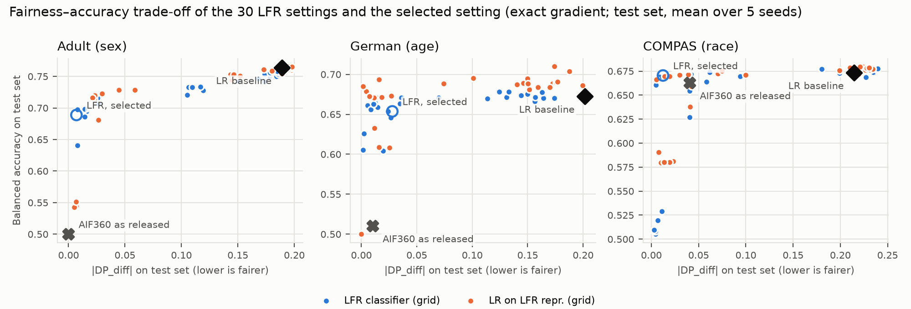

# INFOMDW – Assignment 4: Learning Fair Representations

Evaluation of the bias-mitigation algorithm of

> R. Zemel, Y. Wu, K. Swersky, T. Pitassi and C. Dwork. *Learning Fair Representations.* ICML 2013,
> PMLR 28(3):325–333. [paper](https://proceedings.mlr.press/v28/zemel13.html) ·
> [PDF](https://proceedings.mlr.press/v28/zemel13.pdf)

on Adult, German Credit and COMPAS, with the implementation in
[AIF360](https://github.com/Trusted-AI/AIF360) 0.6.1 (`aif360.algorithms.preprocessing.LFR`).
Assignment: [Assignment 4](https://hqahtan.github.io/Teaching/infomdw/assignments/Assignment_4_26_27.html).

LFR is a **pre-processing** method. It learns a representation of every person (a probability
distribution over k prototypes) that keeps the information in the data, predicts the label, and carries
as little information as possible about the protected attribute (statistical parity of the prototypes). The pipeline in
[`fairness_lfr.ipynb`](fairness_lfr.ipynb) measures the original labels, makes a stratified split, learns
the representation on the training data only, trains the final classifier on the transformed training
data, and measures DP_diff, DIR, consistency, accuracy and balanced accuracy on the transformed test data.

**Main finding about the implementation.** AIF360's `LFR.fit` stops after a handful of L-BFGS iterations
on these datasets. It approximates every gradient by finite differences, one objective evaluation per
parameter (k + k·D parameters), and the default limit `maxfun=5000` counts those evaluations too. The
"fair" result is then usually a model that predicts (almost) everyone in the same class. Here the
identical objective is also minimised with its analytic gradient (`lfr.ExactGradientLFR`: a subclass that
only overrides `fit` to pass the gradient to L-BFGS-B; tested against AIF360). Both versions are reported.

## Setup and running

Requires [uv](https://docs.astral.sh/uv/getting-started/installation/) and internet access for the first
run. uv installs Python 3.12.15 and the exact package versions in `uv.lock`. Tested on macOS (Apple
Silicon); Linux is expected to work but has not been tested. The repository is private: the owner must
grant access before another person can clone it.

```bash
git clone https://github.com/olehertogict/infomdw-assignment-4
cd infomdw-assignment-4
bash reproduce.sh
```

`reproduce.sh` does the following:
- installs the locked environment;
- downloads the three datasets and checks them against recorded SHA256 hashes;
- runs the 19 tests;
- executes the notebook in place: every pipeline step, all 480 LFR fits (3 datasets × 5 seeds × 32), and `results/`.

The saved run took 50 minutes on an M1 Pro with 6 parallel processes. Each of the five Adult tasks
(32 LFR fits on 25k rows) takes about 49 minutes; German and COMPAS take under a minute per seed.

Options:

| Environment variable | Effect |
|---|---|
| `REPRODUCE_QUICK=1` | Smoke test: 1 seed and 3 LFR settings. Takes a few minutes and overwrites `results/`. |
| `REPRODUCE_WORKERS=n` | Number of parallel processes. Default: CPU count − 2. |
| `REPRODUCE_REUSE=1` | Notebook only: keep per-task files in `results/raw/runs/`, to resume an interrupted run. |

To work with the notebook interactively, run `uv sync --locked`, then open `fairness_lfr.ipynb` in
VS Code with the `.venv` kernel, or run `uv run --with jupyterlab jupyter lab`. For a quick check
without experiments, run `uv run pytest -q`.

## What is evaluated (assignment steps)

| Step | Where |
|---|---|
| 1. Three datasets | Adult, German, COMPAS; `datasets.py`; notebook section 1 |
| 2. DP_diff, DIR, consistency of the original labels, before any model | notebook section 2; `results/results.md` §1 |
| 3. Stratified train/test split | `experiment.split`: strata = label × protected group, 70/30; the train part is split again 80/20 into fit/validation |
| 4. Pre-processing: LFR learned on the training data, classifier trained on the transformed data | notebook section 3 (step by step) and section 4 (all runs); `experiment.run_seed` |
| 5. DP_diff, DIR, consistency, accuracy and balanced accuracy of the final test predictions | `results/results.md` §2 |
| 6. Comparison before vs after | notebook section 5; `results/results.md` §1–2; `results/tradeoff.png` |

Two complete pipelines are evaluated on the held-out data:
- **LFR classifier**: the model's own prediction ŷ = Σₖ Mₙₖ·wₖ > 0.5. This is what Zemel et al.
  evaluate, and it equals AIF360's transformed labels.
- **LR on LFR repr.**: a logistic regression trained on the LFR-transformed training data (AIF360's
  transformed features x̂ = Σₖ Mₙₖ·vₖ) with the original labels, then applied to the LFR-transformed
  test data. This is the usual pre-processing pipeline and resembles the paper's §4.3.

The baseline is a logistic regression on the original (z-scored) features without mitigation.

## Datasets

All three are built with AIF360's `StandardDataset`, using the options of AIF360's own dataset classes
and one protected attribute each. Labels: 1 = favourable outcome. Protected attribute: 1 = privileged group.

| Dataset | Source (SHA256-checked) | Rows | Features (one-hot) | Protected (privileged) | Favourable label | Deviation from AIF360's default class |
|---|---|---|---|---|---|---|
| Adult | [UCI 2](https://archive.ics.uci.edu/dataset/2), `adult.data` + `adult.test`; rows with `?` removed | 45,222 | 102 | sex (male) | income > 50K | race is a categorical feature instead of a second protected attribute (AIF360 documents this variant); `fnlwgt` dropped (AIF360 default) |
| German | [UCI 144](https://archive.ics.uci.edu/dataset/144), `german.data` | 1,000 | 61 | age (> 25, as in AIF360 and Kamiran & Calders) | good credit | `personal_status` is kept as a categorical feature; AIF360 replaces it by a derived `sex` |
| COMPAS | [ProPublica](https://github.com/propublica/compas-analysis) at commit `bafff5d`, `compas-scores-two-years.csv`, with ProPublica's filters (as AIF360) | 6,172 | 13 | race (Caucasian) | no recidivism within two years | sex is a categorical feature; `c_charge_desc` (≈ 400 free-text categories) is dropped, so 5 rows that only lacked it are kept |

The paper uses German (Age) and Adult (Gender, 45,222 rows) with the same protected attributes. Its
third dataset, Heritage Health, is no longer publicly available.

## Pipeline and parameters

| Parameter | Value |
|---|---|
| Seeds | 0–4: each seed gives a new stratified split and a new LFR initialisation |
| Split | 30 % test; the remaining 70 % is split 80/20 into fit and validation; stratified on label × protected group |
| Scaling | z-score, fitted on the fit part; used for LFR, logistic regression and consistency |
| LFR | AIF360 objective; k = 10 prototypes; A_x = 0.01; A_y ∈ {0.1, 0.5, 1, 5, 10}; A_z ∈ {0, 0.1, 0.5, 1, 5, 10} (30 settings, the paper's grid); L-BFGS-B with maxiter = maxfun = 5000 (AIF360 defaults); initialisation uniform(0, 1) with `seed`, as in AIF360; threshold 0.5 |
| Model selection | Per seed, on the validation set, with the paper's two criteria: maximum Delta = yAcc − yDiscrim (main result) and minimum yDiscrim. Ties go to higher validation accuracy, then lower A_y, then lower A_z (the paper gives no tie rule) |
| AIF360 as released | `LFR.fit` unchanged, with the setting chosen above, and with AIF360's default (k = 5, A_x = 0.01, A_y = 1, A_z = 50) |
| Classifier | scikit-learn `LogisticRegression(max_iter=1000)`, otherwise defaults (L2, C = 1, lbfgs) |
| DP_diff | P(ŷ=1 \| unprivileged) − P(ŷ=1 \| privileged): AIF360 `statistical_parity_difference` |
| DIR | P(ŷ=1 \| unprivileged) / P(ŷ=1 \| privileged): AIF360 `disparate_impact`; undefined when the privileged rate is 0 |
| Consistency | AIF360 `consistency(n_neighbors=5)` on z-scored features. The value on raw features, which is AIF360 as is, is also saved. AIF360 counts each row as one of its own 5 neighbours |
| Performance | accuracy (the paper's yAcc) and balanced accuracy. Balanced accuracy exposes a constant classifier: it gets 0.5 |

## Where AIF360's LFR differs from the paper

| Paper (Zemel et al. 2013) | AIF360 0.6.1 | Used here |
|---|---|---|
| L-BFGS on the objective (§4.1) | `fmin_l_bfgs_b(approx_grad=True, maxfun=5000)`. Every gradient costs k + k·D objective evaluations, and the limit counts them, so L-BFGS stops after 4 iterations on Adult, 8 on German and about 30 on COMPAS (median) ("TOTAL NO. OF F,G EVALUATIONS EXCEEDS LIMIT") | Both: AIF360 unchanged, and the same objective with its analytic gradient (`lfr.py`; tests check that the objective equals AIF360's to 1e-12 and that the gradient matches finite differences) |
| Distance with learned feature weights α⁺ / α⁻ per group: d = Σᵢ αᵢ(xᵢ − vᵢ)² (Eq. 12) | Plain Euclidean distance ‖x − v‖₂, with no α | AIF360 |
| Sums over rows, features and prototypes (Eq. 7, 8, 10) | Means, so the weight values do not have the same effect as in the paper | AIF360, with the paper's grid of values |
| Hyper-parameter grid A_x = 0.01; A_y, A_z ∈ {0.1, …, 10}; k not reported | Defaults k = 5, A_z = 50 | The paper's grid with k = 10; AIF360's default as an extra reference |
| Transfer: a linear model on M (§4.3) | `transform` returns x̂ = M·V | LR on x̂, a linear function of M |
| yNN (Eq. 15) is printed with 1/(Nk) outside the absolute value | Neighbour mean inside, with the row itself among the k neighbours | AIF360, on z-scored features |

## Results

Values are from the held-out test sets, mean over 5 seeds (± sd in [`results/results.md`](results/results.md)).
For each pipeline the setting is chosen with max Delta on the validation set.

| Dataset | Pipeline | DP_diff | DIR | Consistency | Accuracy | Balanced acc. |
|---|---|---|---|---|---|---|
| Adult | original labels (full data) | −0.199 | 0.363 | 0.828 | – | – |
| | LR baseline | −0.189 | 0.284 | 0.942 | 0.847 | 0.764 |
| | LFR classifier (exact gradient) | −0.007 | 0.957 | 0.968 | 0.818 | 0.689 |
| | LR on LFR repr. (exact gradient) | −0.018 | 0.904 | 0.958 | 0.823 | 0.720 |
| | LFR classifier (AIF360 as released) | 0.000 | undefined | 1.000 | 0.752 | 0.500 |
| German | original labels (full data) | −0.149 | 0.795 | 0.736 | – | – |
| | LR baseline | −0.201 | 0.744 | 0.816 | 0.746 | 0.673 |
| | LFR classifier (exact gradient) | −0.028 | 0.966 | 0.822 | 0.743 | 0.654 |
| | LR on LFR repr. (exact gradient) | 0.011 | 1.015 | 0.841 | 0.729 | 0.633 |
| | LFR classifier (AIF360 as released) | 0.010 | 1.011 | 0.988 | 0.701 | 0.510 |
| COMPAS | original labels (full data) | −0.097 | 0.840 | 0.658 | – | – |
| | LR baseline | −0.214 | 0.714 | 0.970 | 0.682 | 0.673 |
| | LFR classifier (exact gradient) | −0.012 | 0.980 | 0.966 | 0.679 | 0.670 |
| | LR on LFR repr. (exact gradient) | −0.013 | 0.979 | 0.967 | 0.678 | 0.670 |
| | LFR classifier (AIF360 as released) | −0.041 | 0.939 | 0.972 | 0.673 | 0.663 |

What the numbers show (details in [`results/results.md`](results/results.md)):
- **Disparity before mitigation.** The original labels are unbalanced on all three datasets. The
  unmitigated LR baseline increases that disparity on German and COMPAS: DP_diff goes from −0.149 to
  −0.201 and from −0.097 to −0.214.
- **Effect of LFR with exact gradients.** On all three datasets it brings DP_diff close to 0 and DIR
  above the 0.8 of the "80 % rule". The cost in balanced accuracy is 0.075 on Adult, 0.019 on German
  and 0.003 on COMPAS.
- **How parity is reached.** On Adult and COMPAS, parity comes partly from fewer favourable predictions
  for the privileged group. On Adult the share predicted favourable is 0.075 → 0.143 for women and
  0.264 → 0.150 for men; on COMPAS it is 0.536 → 0.602 and 0.751 → 0.614. On German the unprivileged
  group gains (0.589 → 0.761) and the privileged group does not change (0.791 → 0.789).
- **Consistency.** The predictions are much more consistent than the labels, because a model is smooth
  in feature space. LFR changes consistency only a little compared with the baseline (+0.026, +0.006,
  −0.004). A constant classifier gets consistency 1.0, so consistency on its own does not show that
  predictions are good.
- **AIF360 as released.** It reaches "parity" by predicting one class: nobody favourable on Adult in all
  5 seeds, so DIR is undefined; about 98 % favourable on German. Only on COMPAS, which has 13 features
  and therefore 140 parameters, do its 30 iterations give a usable model.
- **Model selection.** The paper's min-yDiscrim criterion selects a constant classifier on Adult and
  German in every seed. Max Delta never did here, but on German the margin over the constant classifier
  (validation Delta 0.70) is small: 0.735–0.812.
- **Grid.** A larger A_z trades balanced accuracy for parity monotonically. At A_z = 10, between 32 % and
  48 % of the fits are constant classifiers.



## Limitations of this evaluation

- **One implementation.** AIF360's objective differs from the paper: no α feature weights, means instead
  of sums, and Euclidean distance. This is therefore an evaluation of LFR as implemented in AIF360, not
  a reproduction of the paper's Figure 1. The paper reports results only as plots, so its numbers
  cannot be compared exactly anyway.
- **Optimisation.** Fixing the gradient is the only change. Initialisation, limits and objective are
  AIF360's. One random start per fit was used; the objective is non-convex.
- **k = 10 is our choice.** The paper does not report it.
- **Variance on German.** With 1,000 rows, the validation set has 140 rows and the test set 300, so the
  selected setting and its test DP_diff vary strongly between seeds (sd 0.113). Five seeds give a rough
  mean, not a confidence interval.
- **Only one classifier and threshold.** The downstream classifier is logistic regression, with a
  decision threshold of 0.5.
- **Protected attribute as a feature.** It stays among the features, as in AIF360's datasets, for the
  baseline and for LFR.
- **Datasets.** The Heritage Health dataset of the paper is not available. COMPAS has its charge
  description dropped, and on German `personal_status` is kept, which also encodes sex.

## Files

```
fairness_lfr.ipynb   the notebook: complete pipeline, step by step and for all runs, with outputs
datasets.py          download (SHA256-checked) and AIF360 construction of the three datasets
lfr.py               ExactGradientLFR (AIF360 LFR + analytic gradient) and fit_aif360 (unchanged fit, with SciPy's report)
metrics.py           DP_diff, DIR, consistency (AIF360), accuracy, balanced accuracy, the paper's selection scores
experiment.py        split, pipelines, grid, model selection, parallel runs -> results/raw/
make_tables.py       results/raw/ -> results/results.md, results/summary.csv, results/tradeoff.png
reproduce.sh         complete setup, checks, notebook execution in one command
tests/               objective/gradient equivalence with AIF360, measures, data, split, selection (uv run pytest)
results/             generated tables, figure and raw per-run results
```
